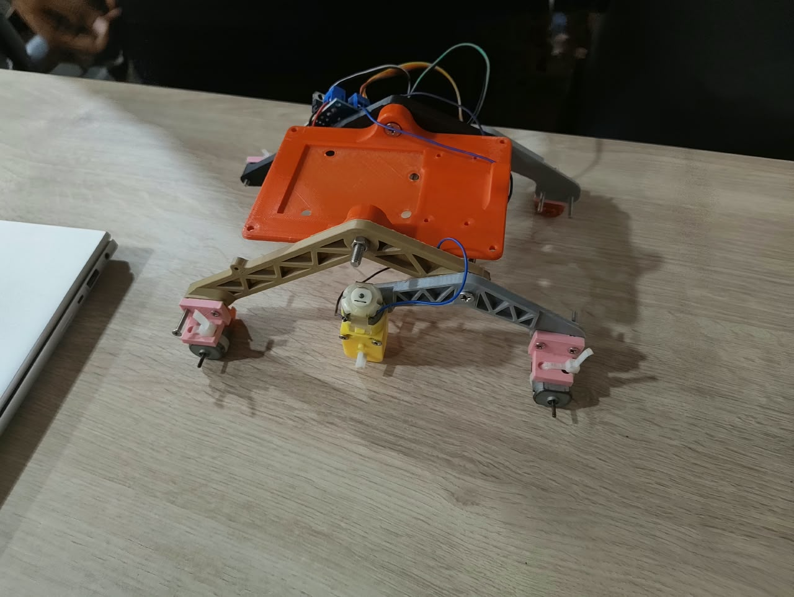

# 🚀 Mars Rover — ESP8266-Based Rover with Live Sensor Dashboard

A Wi-Fi-controlled mobile rover built using the **ESP8266 NodeMCU**, featuring browser-based movement controls and real-time sensor monitoring. The rover hosts its own web dashboard in Access Point (AP) mode, allowing users to control movement and monitor motion and environmental data directly from a smartphone or laptop without requiring an external Wi-Fi router.

## Overview

The system integrates an L293D motor driver with two DC geared motors for differential-drive movement, an MPU6050 accelerometer and gyroscope for motion sensing, a DHT11 sensor for temperature and humidity, and a BMP280 sensor for atmospheric pressure, temperature, and estimated altitude.

The ESP8266 hosts an interactive web interface that displays sensor readings and provides directional controls. An integrated I²C scanner helps identify connected devices, while configurable sensor addresses are saved to EEPROM so they persist across reboots.

## Rover Preview

**Key features**
- Wi-Fi-based rover control through a web browser
- Standalone Access Point mode
- Live motion and environmental sensor dashboard
- Two-motor differential-drive control
- I²C device scanning and sensor-address configuration
- EEPROM-based persistence of sensor addresses

**Access:** Connect to the rover's Wi-Fi network and open `http://192.168.4.1` in a browser.

## Features

### 1. Wi-Fi-Based Rover Control
- Creates a dedicated Wi-Fi network using the ESP8266 in Access Point mode.
- Provides a browser-based directional control interface.
- Supports forward, backward, left, right, and stop commands.

### 2. Live Motion Monitoring
- Uses the MPU6050 accelerometer and gyroscope.
- Displays acceleration along the X, Y, and Z axes.
- Displays angular velocity along the X, Y, and Z axes.
- Calculates approximate tilt angles using accelerometer readings.

### 3. Environmental Monitoring
- **DHT11:** Measures temperature and relative humidity.
- **BMP280:** Measures atmospheric pressure and temperature, and estimates altitude.

### 4. I²C Device Scanner
- Scans the I²C bus for responding device addresses.
- Displays detected addresses in the web dashboard.
- Helps troubleshoot sensor connection and address issues.

### 5. Configurable Sensor Addresses
- Allows the MPU6050 and BMP280 addresses to be selected through the dashboard.
- Stores selected addresses in ESP8266 EEPROM.
- Reinitializes the selected sensor after an address change.

### 6. Live Web Dashboard
- Displays sensor readings through a mobile-friendly web interface.
- Retrieves updated readings using JavaScript and HTTP requests.
- Combines rover controls, sensor information, and I²C configuration in one interface.

- ## Installation

### Hardware Requirements
- ESP8266 NodeMCU development board
- L293D motor driver
- Two DC geared motors and a compatible rover chassis
- MPU6050 accelerometer and gyroscope module
- DHT11 temperature and humidity sensor
- BMP280 pressure sensor
- Suitable power supply, connecting wires, and mounting hardware

### Software Requirements
- Arduino IDE
- ESP8266 board package for Arduino IDE
- Required sensor libraries

### Required Arduino Libraries
Install these libraries using Arduino IDE Library Manager:

- Adafruit MPU6050
- Adafruit Unified Sensor
- Adafruit BMP280 Library
- DHT sensor library by Adafruit

The ESP8266WiFi, ESP8266WebServer, Wire, and EEPROM libraries are provided by the ESP8266 board package or its core environment.

### Uploading the Firmware
1. Install Arduino IDE.
2. Install the ESP8266 board package.
3. Install the required sensor libraries.
4. Open `src/mars_rover.ino` in the Arduino IDE.
5. Select the appropriate ESP8266 NodeMCU board and connected serial port.
6. Upload the firmware.
7. Open the Serial Monitor at 115200 baud to inspect startup messages and sensor initialization status.

## Troubleshooting

| Problem | Possible checks |
|---|---|
| Dashboard does not open | Confirm connection to `MARS_ROVER` and visit `http://192.168.4.1`. |
| MPU6050 not detected | Check SDA, SCL, power, ground, and the configured I²C address. |
| BMP280 not detected | Check wiring and whether the module uses address `0x76` or `0x77`. |
| DHT11 readings are missing | Check the data pin, power, ground, and sensor wiring. |
| Rover moves in the wrong direction | Check motor polarity and the L293D input wiring. |
| Rover does not move | Check motor power, common ground, driver wiring, and motor connections. |
| Sensor values appear inaccurate | Check sensor mounting, wiring, calibration, and operating conditions. |

**Safety note:** Test the rover with its wheels lifted off the ground first. The current firmware should also be improved with a movement-command timeout so the motors stop if communication is interrupted.

